# 👋 Hi, I'm Henrique Rios

**Data Engineer** with hands-on experience as an **Analytics Engineer** at **Indicium**, where I built end-to-end ELT pipelines for clients across the world.

Before data, I spent ~8 years working as an architect. That background still shapes how I work: I care about structure, clear documentation, and building things that make sense to the people who use them. I'm also completing a **Computer Engineering** degree at UEMG Divinópolis.

---

## 💼 What I work on

- **Ingestion & orchestration** — moving data from source systems into the warehouse with Sling and orchestrating pipelines with Dagster
- **Transformation & modeling** — layered dbt projects (staging → intermediate → marts) on Snowflake, with tests and documentation
- **Data quality & delivery** — keeping pipelines reliable and serving clean, analysis-ready data to Power BI
- **Client-facing work** — collaborating with stakeholders in Portuguese, Spanish and English

---

## 🏅 Certifications

- **Databricks Certified Data Engineer Associate**
- **Dagster Essentials**
- **Sigma Partner Delivery Fundamentals**

---

## 🛠️ Skills

### Data and Analytics Engineering

  
  
  
  
  
  
  
  
  
  
  
  

### Development & Tools

  
  
  
  
  
  
  

### Web & Frontend (foundations)

  
  
  
  
  

---

## 🌎 Languages

Portuguese (native) · English (intermediate)

---

## 📊 GitHub Stats

  

> Most of my professional work lives in private client repositories, so public stats only show part of the picture.
